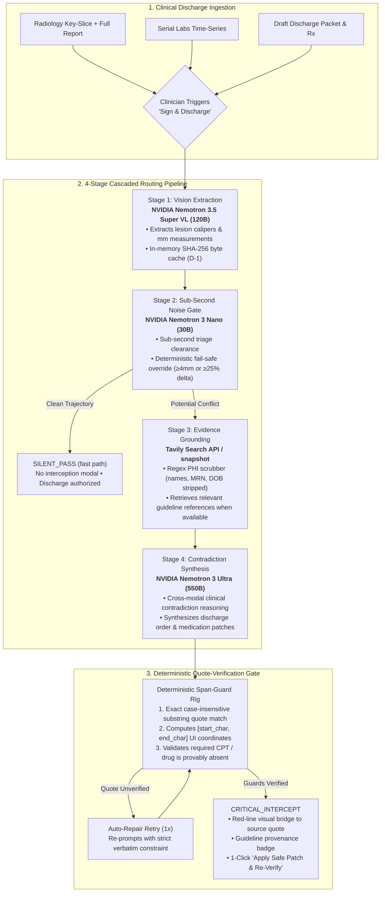
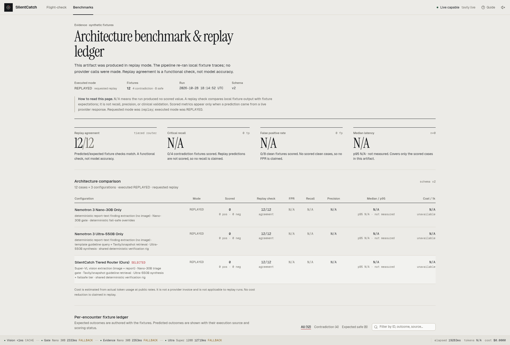
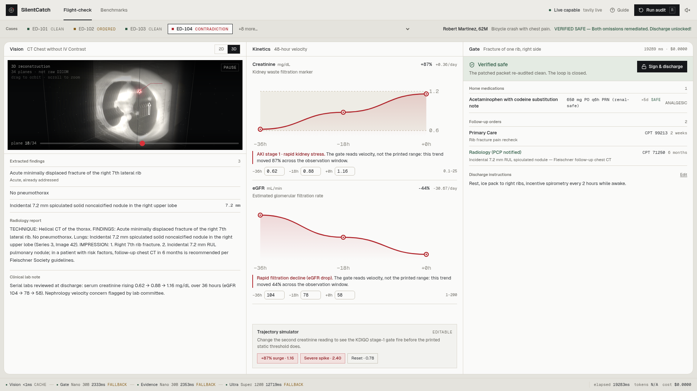
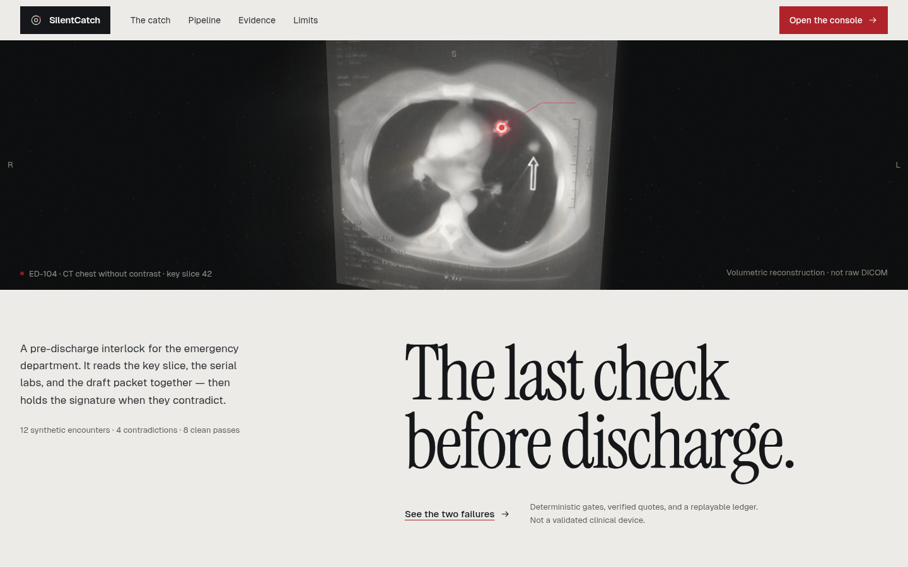

<div align="center">

# SilentCatch

### Real-Time Cross-Modal Clinical Safety Interlock for ER Discharges

[](https://opensource.org/licenses/MIT)
[](https://www.python.org/downloads/)
[](https://fastapi.tiangolo.com/)
[](https://nextjs.org/)
[](https://nebius.com/services/token-factory)
[](https://build.nvidia.com/)
[](https://tavily.com/)
[](https://www.docker.com/)
[]()

<br/>

**A multi-tier safety interlock that runs before the clinician clicks *Sign & Discharge Patient* — designed to surface cross-modal contradictions that routine discharge checks can miss.**

[Overview](#-the-clinical-challenge) • [Architecture](#-system-architecture) • [Benchmarks](#-empirical-benchmarks) • [Console Showcase](#-clinical-flight-check-console) • [Quick Start](#-quick-start) • [API Reference](#-api-reference) • [Privacy Posture](#-data-handling-posture)

<br/>


*SilentCatch running the synthetic ED-104 fixture: a buried 7.2 mm RUL pulmonary nodule and an acute kinetic AKI × Ketorolac collision are surfaced before sign-off. Screenshot from a local run; it is not evidence of clinical validation.*

</div>

---

## 🏥 The Clinical Challenge

In high-volume Emergency Departments (ED), clinicians operate under immense cognitive load, managing multiple deteriorating patients simultaneously. When preparing discharge packets, two silent, high-liability blind spots frequently bypass standard EHR warning systems. The diagram below is an illustrative synthetic failure mode, not a measured outcome:

```
                       THE "SILENT TRAP" OF ROUTINE ER DISCHARGES

   ┌───────────────────────────────────────┐    ┌───────────────────────────────────────┐
   │      1. Buried Incidental Nodule      │    │    2. "Normal Box" Kinetic Collapse   │
   ├───────────────────────────────────────┤    ├───────────────────────────────────────┤
   │ Trauma CT rule-out for rib fracture   │    │ Serial Creatinine: 0.62 → 0.88 →      │
   │ Radiologist notes 7.2 mm incidental   │    │ 1.16 mg/dL (+87% delta in 36h).       │
   │ nodule on image slice #42.            │    │ Still within reference (0.6-1.20).    │
   │                                       │    │                                       │
   │ Outcome: Missed in acute discharge    │    │ Outcome: Clinician prescribes         │
   │ instructions; patient presents 2      │    │ Ketorolac (Toradol), precipitating    │
   │ years later with Stage IV cancer.     │    │ acute tubular necrosis (ATN).         │
   └───────────────────────────────────────┘    └───────────────────────────────────────┘
```

### Why Conventional Clinical Decision Support (CDS) Fails
Alert fatigue is a widely reported problem: modal-heavy decision support is easy to dismiss reflexively. SilentCatch is designed to avoid adding another routine pop-up by gating on deterministic risk signals first.

### The SilentCatch Paradigm
- **Quiet fast path on clean fixtures:** In this prototype, routine safe encounters can clear through the deterministic gate without opening an interception modal. The reference latency budgets are design targets, not measured clinical performance.
- **Synchronized interception on contradictions:** When cross-modal contradictions collide (e.g. imaging finding vs. discharge order, or kinetic lab trajectory vs. prescribed drug), SilentCatch halts sign-off, draws visual red-lines connecting source evidence to the draft packet, cites retrieved guidelines when available, and offers a 1-click patch-and-reverify loop.

---

## ⚡ System Architecture

SilentCatch coordinates open-weight **NVIDIA Nemotron** frontier models hosted on **Nebius Token Factory**, real-time medical guideline retrieval via **Tavily Search API**, and deterministic analytical kinematic mathematics.



### Stage Details

Latency values below are design budgets, not measured production results. Live behaviour depends on provider load, model routing, and network conditions.

| Stage | Engine / Model | Latency Budget | Primary Responsibility |
| :--- | :--- | :---: | :--- |
| **Stage 1: Vision** | `Nemotron-3.5-Super-VL-120B` | ~400 ms | Ingests key-slice CT/X-ray and report; extracts mm findings and ROI coordinates. |
| **Stage 2: Gate** | `NVIDIA-Nemotron-3-Nano-30B` | ~250 ms | Triage filter for clean discharges. Deterministic fail-safes override model if findings $\ge 4\text{mm}$ or lab delta $\ge 25\%$. |
| **Stage 3: Evidence** | `Tavily Search API` | ~300 ms | Outbound query scrubbed of PHI; retrieves governing clinical literature (`pubs.rsna.org`, `kdigo.org`, `fda.gov`). |
| **Stage 4: Reasoning** | `Nemotron-3-Ultra-550B` | ~600 ms | Synthesizes structured clinical patches. Proposes candidates with verbatim source quotes. |
| **Verification Gate** | Deterministic Python Rig | < 1 ms | Verifies quotes exist in the chart, computes UI character offsets, and blocks unverified proposals from surfacing. |

---

## 📊 Benchmark: Replay vs. Live

The repository ships a benchmark harness over **12 synthetic development fixtures** (8 expected-safe, 4 expected-contradiction) across 3 configurations. The artifact in [`eval/results_latest.json`](eval/results_latest.json) must be read together with its `meta.mode`:

- **Replay (`make benchmark`)** — re-executes the recorded pipeline locally. It makes **no provider calls**, so it produces **no model accuracy, token, latency, or cost metrics**. Its only score-like value is a replay check: whether the local fixture path reproduces the fixture expectations. `scored_cases` is `0` and model metrics are `null` (shown as `N/A` in the UI).
- **Live (`make benchmark-live`)** — runs the configured provider path and scores only predictions that actually came from live responses. It requires `NEBIUS_API_KEY` (and optionally `TAVILY_API_KEY`) and may incur cost. Live results are still limited to these synthetic fixtures and do **not** establish clinical sensitivity, specificity, or real-world safety.

The console's **MODEL BENCHMARKS** tab renders `meta.mode`, `scored_cases`, `prediction_source`, per-case provenance, fallback status, and nullable metrics from the artifact. It never substitutes replay agreement for recall or precision.

<details>
<summary>What the generated artifact contains</summary>

```json
{
  "schema_version": 2,
  "meta": {
    "mode": "REPLAYED",
    "requested_mode": "replay",
    "environment": "REPLAYED",
    "total_encounters": 12,
    "positive_cases": 4,
    "negative_cases": 8
  },
  "summary": {
    "tiered_router": {
      "mode": "REPLAYED",
      "scored_cases": 0,
      "replay_check_matches": 12,
      "replay_check_total": 12,
      "recall_pct": null,
      "precision_pct": null,
      "fpr_pct": null,
      "median_latency_ms": null,
      "cost_type": "not_applicable_replay"
    }
  }
}
```

Actual values depend on the run; inspect `eval/results_latest.json` rather than copying numbers from this example.

</details>

<br/>


*Screenshot of the benchmark tab. The tab labels replay mode explicitly; replay agreement is a functional check, not a clinical validation result.*

---

## 🖥️ Clinical Flight-Check Console

The interface is engineered as a single bone-paper sheet: the imaging chamber is the only dark material, and the three columns — imaging, kinetics, discharge gate — are separated by hairlines rather than nested cards. Below `1280px` the columns stack; above it, the sheet holds its three-column flight-check layout:

```
┌────────────────────────────────────────────────────────────────────────────────────────┐
│ SILENTCATCH  ER Pre-Discharge Flight-Check   [FLIGHT-CHECK] [MODEL BENCHMARKS]  ED-104 │
├──────────────────────────────┬──────────────────────────────┬──────────────────────────┤
│ PANE 1: RADIOLOGY KEY-SLICE  │ PANE 2: 48-HR LAB VELOCITY   │ PANE 3: DISCHARGE EDITOR │
│                              │                              │                          │
│ • 256×256 Key-Slice Viewer   │ • OLS Linear Trajectory Math │ • Primary ICD-10 & Rx    │
│ • Red ROI Caliper Ring       │ • KDIGO AKI 1/2/3 Alarm Bands│ • Interception Cards     │
│ • Verbatim Span-Guard Quote  │ • Interactive Judge Sandbox  │ • Tavily Clinical Badges │
│   Offset Highlighting        │ • Real-time bounds (0.1-25.0)│ • 1-Click Patch & Verify │
├──────────────────────────────┴──────────────────────────────┴──────────────────────────┤
│ TELEMETRY: S1: VISION (32ms) | S2: GATE (18ms) | S3: TAVILY (95ms) | S4: ULTRA (410ms) │
└────────────────────────────────────────────────────────────────────────────────────────┘
```

### The 1-Click Closed Loop: Before vs. After Patch

| Step 1: Interception (`CRITICAL_INTERCEPT`) | Step 2: Verified Safe (`VERIFIED_SAFE`) |
| :---: | :---: |
|  |  |
| Halts sign-off; highlights buried 7.2 mm nodule and draws red-line to missing CPT 71250 order. Flags kinetic AKI creatinine delta. | Clinician clicks **"Apply patch & re-verify"**. The packet updates in place, re-audits clean, and unlocks the green sign-off state. |

### 3D reconstruction


*The 3D tab stacks 34 planes of the single fixture key slice. It is a reconstruction, not a DICOM volume; the slice control and the ROI beacon ride the emphasised plane.*

### The landing page


*The public entry point at `/`: a scroll-driven reconstruction of the ED-104 key slice above the fold, with the fixture ledger and the two failure modes below. The console lives at `/console`.*

---

## 🚀 Quick Start

### Prerequisites
- [Docker](https://docs.docker.com/get-docker/) & [Docker Compose](https://docs.docker.com/compose/) **OR**
- [Python 3.11+](https://www.python.org/) and [Node.js 18+](https://nodejs.org/)

### Option 1: Docker Compose (Recommended)

Run the full stack (FastAPI on `:8000`, Next.js on `:3000`) with zero configuration:

```bash
# Clone the repository
git clone https://github.com/Divyanshu-kumar14/SilentCatch.git
cd SilentCatch

# Build and launch containers
make judge-demo
```

Open [http://localhost:3000](http://localhost:3000) in your browser.

> [!NOTE]
> When API keys are unset, SilentCatch automatically uses the **deterministic replay/seed path** with recorded fixture traces. Backend tests, the console workflow, and the replay benchmark run offline. Replay verifies fixture plumbing, not model accuracy, latency, or cost.

---

### Option 2: Local Development Setup

```bash
# 1. Install dependencies (creates .venv and installs node_modules)
make install

# 2. Run backend (:8000) and frontend (:3000) concurrently
make dev
```

### Optional: Enabling Live Frontier Inference

To enable live inference through Nebius Token Factory and live Tavily search queries, create a `.env` file in the root directory:

```bash
cp .env.example .env
```

Add your keys to `.env`:
```ini
NEBIUS_API_KEY=your_nebius_token_factory_key
TAVILY_API_KEY=your_tavily_search_api_key
```

### Run the Benchmark & Verification Tests

```bash
# Replay benchmark: no provider calls; syncs the frontend artifact
make benchmark

# Explicit live benchmark: requires NEBIUS_API_KEY, may incur provider charges
# Prefer a one-case smoke first:
# ./.venv/bin/python eval/benchmark.py --live --smoke --case ED-104
make benchmark-live

# Backend unit & integration tests
./.venv/bin/python -m pytest backend/tests -q

# Frontend lint, type-check, and production build
npm --prefix frontend run lint
npm --prefix frontend run build
```

The frontend reads a static copy at `frontend/src/data/results_latest.json`; both benchmark targets call `make sync-benchmark-artifact` so the UI cannot drift from `eval/results_latest.json`.

---

## 🔌 API Reference

### Liveness & Telemetry
```http
GET /healthz
```
Returns configured live capability, resolved model IDs, Tavily configuration, and active spend caps. It reports configuration only; it does not make a provider call.

```json
{
  "status": "ok",
  "inference_mode": "LIVE_CAPABLE",
  "live_capable": true,
  "mode_note": "NEBIUS_API_KEY configured; audits may call the provider. This health check makes no model call.",
  "nebius_base_url": "https://api.tokenfactory.nebius.com/v1",
  "models": {
    "vision": "nvidia/Nemotron-3.5-Super-VL",
    "gate": "nvidia/NVIDIA-Nemotron-3-Nano-30B-A3B",
    "reasoning": "nvidia/Nemotron-3-Ultra-550b-a55b",
    "failsafe": "nvidia/nemotron-3-super-120b-a12b"
  },
  "tavily_configured": true,
  "spend_caps": {
    "per_discharge_usd": 0.05,
    "daily_usd": 2.00
  }
}
```

When no key is configured, the same endpoint returns `"inference_mode": "REPLAY_ONLY"` and `"live_capable": false`. `tavily_live` remains as a deprecated alias for `tavily_configured`.

---

### Patient Encounters
```http
GET /api/encounters
```
Returns all available patient fixtures formatted for the clinical cockpit view (expected findings stripped).

---

### Benchmark Results
```http
GET /api/benchmark
```
Returns the cached `eval/results_latest.json` artifact consumed by the console's **MODEL BENCHMARKS** tab. Consumers must branch on `meta.mode`, `scored_cases`, and nullable metrics; replay artifacts contain no model accuracy, latency, or cost values.

---

### Streaming Safety Interlock (SSE)
```http
POST /api/audit-stream
Content-Type: application/json
```

**Payload:**
```json
{
  "encounter_id": "ED-104",
  "encounter": null
}
```
*(Optionally provide a mutated `encounter` object to run the 1-click re-verification loop).*

**Server-Sent Event Stream Format:**
```
event: run_start
data: {"encounter_id": "ED-104", "mode": "REPLAYED", "daily_spend_usd": 0.0}

event: stage_start
data: {"stage": "vision"}

event: stage_done
data: {"stage": "vision", "findings": [...], "vision_confidence": "HIGH"}

event: stage_start
data: {"stage": "gate"}

event: stage_done
data: {"stage": "gate", "decision": {"action": "ESCALATE", "reasons": [...]}}

event: stage_start
data: {"stage": "guideline"}

event: stage_done
data: {"stage": "guideline", "guidelines": [...]}

event: stage_start
data: {"stage": "reasoning"}

event: stage_done
data: {"stage": "reasoning", "verdicts": [...]}

event: verdict
data: {"status": "CRITICAL_INTERCEPT", "verdicts": [...], "total_cost_usd": 0.0, "execution_mode": "REPLAYED"}

event: done
data: {"status": "CRITICAL_INTERCEPT", "verdicts": [...], "elapsed_ms": 7, "execution_mode": "REPLAYED"}
```

---

## 🔒 Data-Handling Posture

This section describes the prototype's intended data flow. It is **not** a HIPAA certification, nor a guarantee about third-party provider retention.

1. **Provider-hosted inference**: Live inference is sent to [Nebius Token Factory](https://nebius.com/services/token-factory) using open-weight NVIDIA Nemotron models. Retention and logging are governed by the provider's terms and configuration; this repository does not independently certify them. Replay mode makes no provider call.
2. **Outbound query scrubbing**: Before a Tavily search request, the query path applies a deterministic regex scrubber intended to remove names, medical record numbers, and dates of birth. The scrubber is a prototype safeguard, not a formal de-identification certification; review and validate it before any real patient data is used.
3. **In-process spend circuit breakers**: In-memory ledgers enforce:
   - **$0.05 USD** budget per discharge evaluation.
   - **$2.00 USD** budget per day.
   The caps are process-local and reset on restart. When a cap is reached, the audit falls back to the deterministic replay path instead of making further provider calls.

---

## 📁 Repository Map

```
SilentCatch/
├── backend/
│   ├── config.py                 # Nebius/Tavily config, model IDs & spend caps
│   ├── main.py                   # FastAPI REST entrypoint, SSE streaming & image server
│   ├── schemas.py                # Strict Pydantic v2 data models & validation
│   ├── engine/
│   │   ├── pipeline.py           # 4-stage SSE orchestrator & thread pool worker
│   │   ├── vision_extractor.py   # Nemotron 3.5 Super VL image/text extractor & cache
│   │   ├── noise_gate.py         # Nemotron 3 Nano triage gate with deterministic overrides
│   │   ├── guideline_search.py   # PHI-scrubbed Tavily guideline retrieval & snapshot cache
│   │   ├── contradiction_ultra.py# Nemotron 3 Ultra deep cross-modal reasoning
│   │   ├── span_guard.py         # Zero-hallucination substring quote verifier & LRU cache
│   │   ├── kinematic_labs.py     # Analytical OLS serial lab velocity & KDIGO AKI engine
│   │   ├── telemetry.py          # Real-time token pricing, spend ledger & caps
│   │   └── replay.py             # ReplayStore for deterministic offline execution
│   └── fixtures/                 # 12 synthetic ER encounters, key-slice PNGs & guideline cache
├── frontend/                     # Next.js 14 light-table landing + console
│   ├── src/app/                  # App router: `/` landing, `/console` flight-check
│   ├── src/components/
│   │   ├── Console.tsx           # Console shell, audit stream & keyboard shortcuts
│   │   ├── ScanViewer.tsx        # Left pane: radiology key-slice + Span-Guard highlight
│   │   ├── LabSparkline.tsx      # Center pane: kinetic sparklines + judge sandbox
│   │   ├── DischargeEditor.tsx   # Right pane: discharge summary + 1-click patch loop
│   │   ├── TelemetryBar.tsx      # Bottom bar: progressive pipeline telemetry & spend ledger
│   │   ├── BenchmarkView.tsx     # Lazy-loaded Model Benchmarks visualization tab
│   │   └── landing/              # Landing page, scroll film & 3D volume components
│   ├── src/lib/                  # API client, analytical clinical math & volume-scene engine
│   └── test-phase3.cjs           # Playwright automated 6-step console verification suite
├── eval/
│   ├── benchmark.py              # Reproducible 12-case × 3-config evaluation harness
│   └── results_latest.json       # Empirical benchmark output artifact
├── docs/assets/                  # Console screenshot artifacts
├── Dockerfile                    # Container definition
├── docker-compose.yml            # Multi-service local & cloud compose file
├── Makefile                      # make dev, make judge-demo, make benchmark, make benchmark-live
└── LICENSE                       # MIT License
```

---

## 📄 License

This project is open-source software licensed under the [MIT License](LICENSE).

<div align="center">
<sub>An experimental prototype for surfacing cross-modal discharge contradictions. Not a validated clinical device.</sub>
</div>
