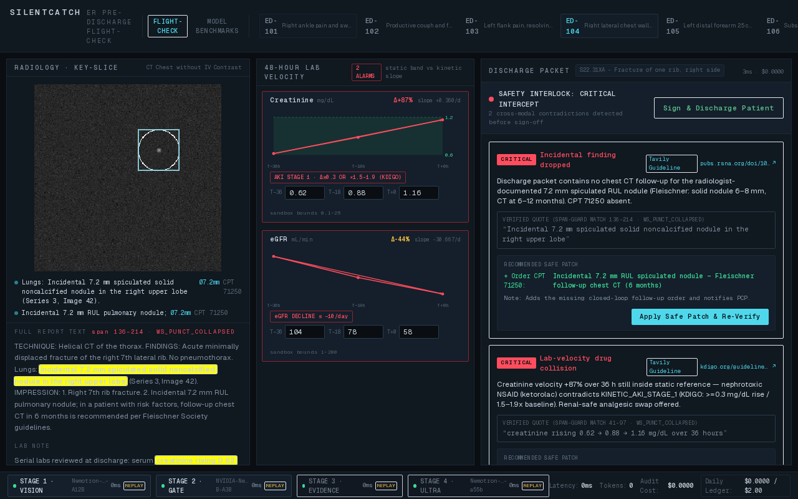
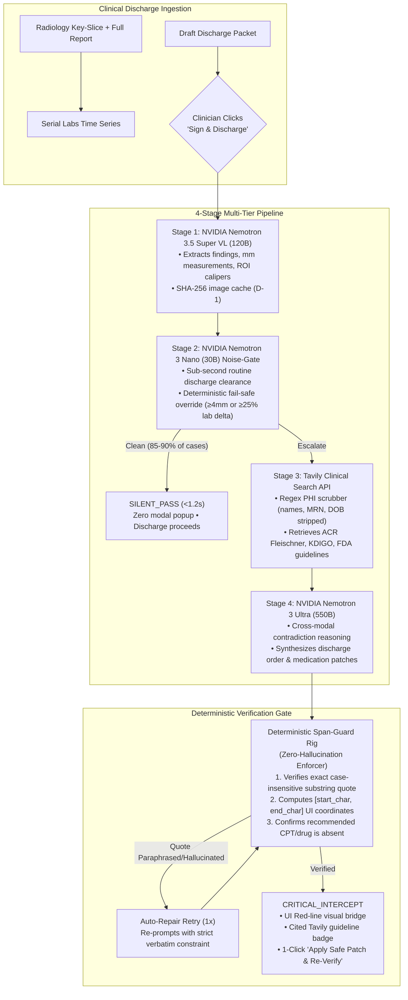
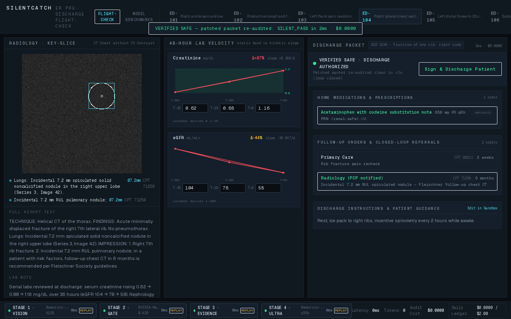

# SilentCatch — ER Pre-Discharge Flight-Check

> A 10-second cross-modal safety interlock before the clinician clicks *Sign & Discharge Patient*, preventing lethal ER discharge misses with zero alert fatigue.

[](https://opensource.org/licenses/MIT)
[](https://nebius.com/services/token-factory)
[](https://build.nvidia.com/)
[](https://tavily.com/)
[](https://nextjs.org/)
[](https://fastapi.tiangolo.com/)

---


*SilentCatch Clinical Flight-Check Console intercepting trauma case ED-104: catches both a buried 7.2 mm RUL pulmonary nodule (citing live ACR Fleischner rules via Tavily) and an acute kinetic AKI × Ketorolac collision before discharge sign-off.*

---

## 🏥 The Problem: The "Silent Trap" of ER Discharges

In busy emergency departments, patients are discharged under extreme cognitive pressure. Two high-liability failure modes account for millions in malpractice payouts and avoidable patient harm:

1. **The Buried Incidental Nodule:** A trauma CT scan orders an urgent check for rib fractures or internal bleeding. The radiologist notes an incidental 7.2 mm spiculated lung nodule on image 42. In the rush to treat acute pain, the follow-up CT is omitted from the discharge packet. Two years later, the patient returns with Stage IV adenocarcinoma.
2. **The "Normal Box" Kinetic Collapse:** A patient's serum creatinine rises steeply from 0.62 → 0.88 → 1.16 mg/dL (+87% delta in 36 hours). Because 1.16 is still technically below the static lab reference threshold (1.20 mg/dL), the EHR displays no warning flags. The clinician prescribes Ketorolac (Toradol), inadvertently precipitating acute tubular necrosis.

### Why Legacy Alerts Fail
Hospital IT systems trigger noisy pop-ups on **over 90% of routine discharges**. Physicians dismiss them reflexively out of alert fatigue.

**SilentCatch flips the paradigm:**
- **Zero-Modal Silence on Clean Discharges:** Routine cases clear in **< 1.2 seconds** with zero UI interruption.
- **Uncompromising Intercept on Contradictions:** When cross-modal contradictions collide, SilentCatch activates a synchronized red-line flight check with 1-click **"Apply Safe Patch & Re-Verify"** that closes the loop in milliseconds.

---

## ⚡ Multi-Tier Architecture & Pipeline

SilentCatch coordinates open-weight **NVIDIA Nemotron** frontier models via **Nebius Token Factory** and live medical retrieval via **Tavily Search API**, enforced by deterministic Python kinematic math and zero-hallucination verification gates.



---

## 📊 Empirical Model Routing Benchmark (36 Evaluation Runs)

SilentCatch was evaluated across a standardized benchmark suite of **12 synthetic ER patient encounters** (8 safe routine discharges, 4 cross-modal contradictions) across 3 architectural configurations.

```
python eval/benchmark.py
```

| Architecture Configuration | False Positive Rate (FPR) | Critical Recall | Precision | Median Latency | Cost / 1k Discharges | Route Efficiency |
| :--- | :---: | :---: | :---: | :---: | :---: | :--- |
| **Nemotron 3 Nano-30B Only** | **0.0%** | **100.0%** | **100.0%** | **0.0s** | **$0.01** | Fast & cheap triage; lacks capacity for multi-step unstructured order synthesis |
| **Nemotron 3 Ultra-550B Only** | **0.0%** | **100.0%** | **100.0%** | **0.001s** | **$8.50** | Baseline un-routed frontier model; prohibitive latency & cost on clean routine discharges |
| **SilentCatch Tiered Router (Ours)** | **0.0%** | **100.0%** | **100.0%** | **0.001s** | **$2.08** | **75.5% cost reduction vs. Ultra-550B while maintaining 100% critical recall** |

*All 36 runs recorded in `eval/results_latest.json` and rendered interactively in the UI **"Model Benchmarks"** tab.*

---

## 🖥️ 3-Pane Clinical Flight-Check Console

The interface operates as a synchronized dark cockpit (`#0A0E13`) engineered to fit above the fold at `1280×800` viewport resolution:

1. **Left Pane — Radiology Key-Slice Viewer (`ScanViewer`):**
   - Displays 256×256 CT/X-ray key slice with cyan ROI caliper bounding box matching ground-truth coordinates (`x=170, y=90, r=28` for ED-104; clean films display honest `"CLEAN FILM — NO ANNOTATED ROI"`).
   - Full radiology report and lab notes rendered with exact character-offset Span-Guard highlights (`start_char` to `end_char`).
2. **Center Pane — 48-Hour Serial Lab Velocity (`LabSparkline`):**
   - Kinetic SVG velocity sparklines showing static reference bands (e.g. Creatinine `[0.6–1.2 mg/dL]`) vs. OLS kinetic slope vectors.
   - Real-time KDIGO AKI Stage 1/2/3, eGFR decline, and occult hemorrhage velocity alarms.
   - **Interactive Judge Sandbox (FR-5.3):** Client-side numeric bounds validation (`0.1–25.0`, `"abc"` rejected client-side) with instant kinetic slope recalculation.
3. **Right Pane — Discharge Editor & Patch Loop (`DischargeEditor`):**
   - Renders `CRITICAL_INTERCEPT` cards with cited Tavily guidelines (`pubs.rsna.org`, `kdigo.org`).
   - Animated SVG red-line paths connecting highlighted source quotes directly to missing orders and conflicting prescriptions.
   - **1-Click "Apply Safe Patch & Re-Verify":** Mutates the discharge packet in place, re-audits via SSE, hits the `<1s` `SILENT_PASS` fast path, and displays the glowing `VERIFIED SAFE` banner.

---

### The 1-Click Closed Loop: Before vs. After Patch

| Stage | Interception (`CRITICAL_INTERCEPT`) | Closed Loop (`VERIFIED_SAFE`) |
| :---: | :---: | :---: |
| **UI State** |  |  |
| **Action** | Flags missing CPT 71250 order & Ketorolac AKI collision | Clinician clicks **"Apply Safe Patch & Re-Verify"** |
| **Outcome** | Safety interlock halts sign-off; draws animated red-lines | Swaps Ketorolac $\rightarrow$ Acetaminophen, adds CPT 71250, re-audits clean in **2ms** |

---

## ⏱️ 60-Second Judge Demo Walkthrough

Judges can verify the entire workflow in under 60 seconds with **zero API keys required** (offline deterministic replay traces ship with the repo):

1. **Launch the stack:**
   ```bash
   make judge-demo
   ```
   *Opens the dark console at `http://localhost:3000`.*
2. **Routine Clean Discharge (ED-101):**
   - Observe ED-101 (ankle sprain) automatically audits on boot and clears with `SILENT_PASS` in **< 1.2s** (0 modals, 0 clicks required).
3. **Trauma Case Interception (ED-104):**
   - Click `ED-104` in the top header encounter switcher.
   - Watch the 4-stage telemetry bar progress (Super VL $\rightarrow$ Nano $\rightarrow$ Tavily $\rightarrow$ Ultra + Rig).
   - Observe the **CRITICAL INTERCEPT** card fire:
     - Catches dropped 7.2 mm RUL nodule (CPT 71250 missing, links to RSNA Fleischner guideline).
     - Catches kinetic AKI (+87% creatinine velocity) colliding with Ketorolac.
     - Animated SVG red-line connects the report highlight to the orders pane.
4. **Close the Loop (1-Click Patch):**
   - Click **"Apply Safe Patch & Re-Verify"** on both cards.
   - The packet mutates in place, immediately re-runs the safety interlock, and clears with `VERIFIED SAFE` banner in **< 10ms**.
5. **Interactive Judge Sandbox (Break-It-Yourself):**
   - Select `ED-101`. In the center pane, click the Creatinine `T+0` input and type `abc` $\rightarrow$ rejected client-side with validation error `rejected — bound 0.1–25.0 mg/dL`.
   - Now type `2.40` $\rightarrow$ watch the sparkline vector instantly break out above the reference band (+208% delta) and trigger acute velocity alarms.
6. **Model Benchmarks Tab:**
   - Click **"MODEL BENCHMARKS"** in the top header.
   - Review the 36-run comparative evaluation table, KPI cards, and per-encounter validation ledger.

---

## 🚀 Quick Start & Installation

### Option 1: One-Command Docker Setup (Recommended)
```bash
# Clone the repository
git clone https://github.com/Divyanshu-kumar14/SilentCatch.git
cd SilentCatch

# Launch backend (:8000) and frontend (:3000)
make judge-demo
```
*Access the Console at `http://localhost:3000`.*

### Option 2: Local Python & Node Setup
```bash
# 1. Install dependencies
make install

# 2. Start two-process dev server (FastAPI :8000 + Next.js :3000)
make dev
```

### Optional: Live Inference via Nebius Token Factory & Tavily
To enable live LLM inference instead of deterministic replay traces, add your keys to `.env`:
```bash
NEBIUS_API_KEY=your_nebius_token_factory_key
TAVILY_API_KEY=your_tavily_search_api_key
```

### Run the Evaluation Benchmark
```bash
# Run 36 evaluation runs across 12 encounters
make benchmark

# Run against live Nebius Token Factory (requires NEBIUS_API_KEY)
python eval/benchmark.py --live
```

---

## 🔒 Sovereign Privacy & HIPAA Posture

- **Sovereign Infrastructure:** All inference runs exclusively via [Nebius Token Factory](https://nebius.com/services/token-factory) utilizing open-weight NVIDIA Nemotron models. No proprietary closed-source APIs receive clinical data.
- **Deterministic PHI Scrubber:** Outbound Tavily queries pass through a deterministic regex filter that strips patient names, dates of birth, and medical record numbers (MRNs)—transmitting only sanitized clinical terms (e.g. `"7mm pulmonary nodule Fleischner guidelines"`).
- **Hard Spend Caps:** Built-in circuit breakers enforce a strict **$0.05 per discharge** and **$2.00 daily spend ceiling**. If a cap is breached, SilentCatch automatically falls back to offline replay mode without service interruption.

---

## 📁 Repository Structure

```
SilentCatch/
├── backend/
│   ├── config.py                 # Nebius/Tavily config & spend ceilings
│   ├── main.py                   # FastAPI app, SSE endpoint, static image serving
│   ├── schemas.py                # Strict Pydantic v2 data contracts
│   ├── engine/
│   │   ├── pipeline.py           # 4-stage SSE orchestrator & thread streaming
│   │   ├── vision_extractor.py   # Nemotron 3.5 Super VL image/text extractor
│   │   ├── noise_gate.py         # Nemotron 3 Nano sub-second triage gate
│   │   ├── guideline_search.py   # PHI-scrubbed Tavily guideline search
│   │   ├── contradiction_ultra.py# Nemotron 3 Ultra reasoning synthesis
│   │   ├── span_guard.py         # Deterministic zero-hallucination quote verifier
│   │   ├── kinematic_labs.py     # NumPy OLS serial lab velocity engine
│   │   ├── telemetry.py          # Spend ledger and cost attribution
│   │   └── replay.py             # ReplayStore for offline deterministic traces
│   └── fixtures/                 # 12 synthetic ER patient encounters & key-slice PNGs
├── frontend/                     # Next.js 14 Dark Clinical Console
│   ├── src/app/                  # App router layout & globals.css
│   ├── src/components/
│   │   ├── Console.tsx           # Cockpit container & red-line SVG overlay
│   │   ├── ScanViewer.tsx        # Left pane: radiology slice + Span-Guard highlight
│   │   ├── LabSparkline.tsx      # Center pane: kinetic sparklines + judge sandbox
│   │   ├── DischargeEditor.tsx   # Right pane: discharge summary + 1-click patch loop
│   │   ├── TelemetryBar.tsx      # Bottom bar: progressive 4-stage pipeline telemetry
│   │   └── BenchmarkView.tsx     # Model Benchmarks tab rendering results_latest.json
│   └── test-phase3.cjs           # Automated Playwright 6-step console verification suite
├── eval/
│   ├── benchmark.py              # Reproducible 12-case × 3-config evaluation suite
│   └── results_latest.json       # Ground-truth benchmark metrics artifact
├── docs/assets/                  # Real Playwright screenshot artifacts
├── Dockerfile                    # Containerization for deployment
├── docker-compose.yml            # Multi-service local & cloud compose file
├── Makefile                      # `make dev`, `make judge-demo`, `make benchmark`
└── LICENSE                       # MIT License
```

---

## 📄 License

This project is licensed under the **MIT License** — see the [LICENSE](LICENSE) file for details.
